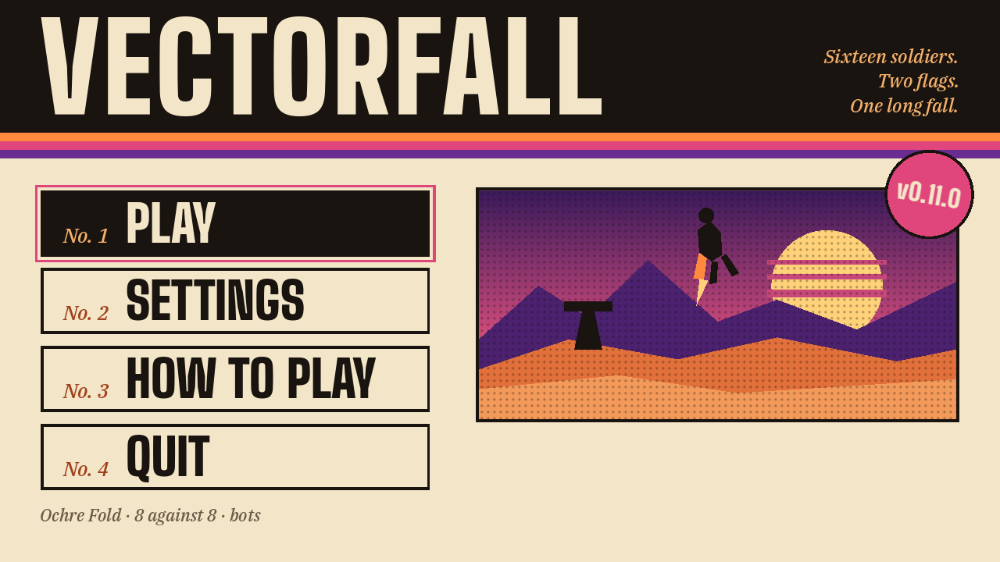
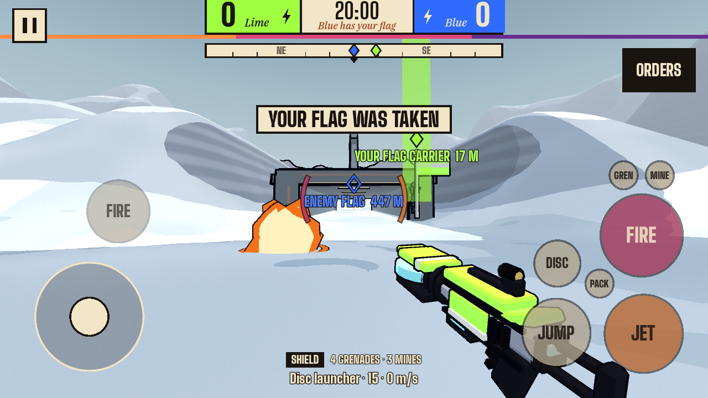
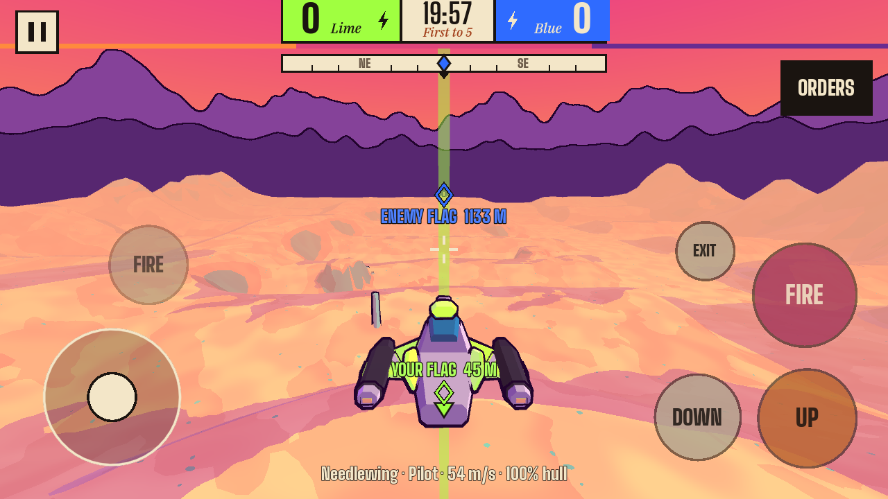
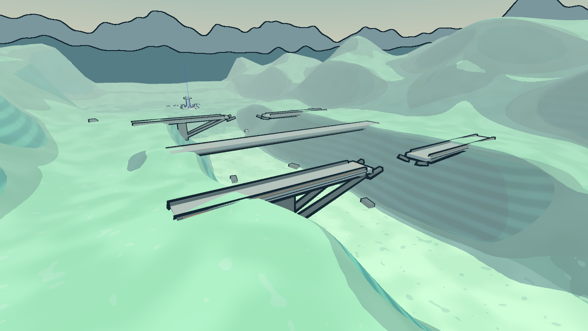

# Vectorfall

Vectorfall is a capture-the-flag shooter for Android and Linux. Ski down a hill, jet over the next ridge and bring the other team's flag home. Take a gunship up to cover your runner, or go in on foot and knock out the enemy generator.

It's in the spirit of Tribes, with bots you can play a whole match with and the look of an old science fiction paperback. Two teams of up to eight play on ten arenas. Bots change jobs as the match goes, chase flag carriers, repair the base and take orders from you.

New in 0.11.0

- Nine new arenas, including the foundry yard on Nightline Foundry, the tunnel on White Signal and the high bridge on Glass Ravine.
- Ski Practice teaches you to ski downhill, jet over a crest and grab a flag. It keeps your best time.
- Ten original music tracks, more sound effects and clearer cues for hitting a shield, landing a direct shot in the air and stopping a carrier.
- One attacking bot per team goes for the flag on foot while the other attackers can take vehicles or attack the base.

This build is for offline play with bots. Online play is planned. Let me know what works and what doesn't, or open an issue here.

Enjoy, 
Dan

---

## Screenshots

<table>
  <tr>
    <td align="center"> Main menu</td>
    <td align="center"> White Signal</td>
  </tr>
  <tr>
    <td align="center"> Ski Practice</td>
    <td align="center"> Flying a Needlewing</td>
  </tr>
  <tr>
    <td align="center"> Glass Ravine</td>
    <td align="center"> Gannet Reach</td>
  </tr>
</table>

---

## Devices

The Android build supports Android 7.0 and up on 64-bit and 32-bit ARM. The Moto Stylus 2024 and Galaxy Tab A11+ ran earlier builds. On the Fire HD 8, 0.11.0 ran Ski Practice and an 8v8 match on Nightline Foundry. The match averaged about 10 frames a second there. Try fewer bots on older hardware.

The Linux build is for x86-64. It supports mouse and keyboard and a gamepad. Android also supports touch controls, gyro aim and adjustable aim assist.

## Install

If you have the signed `vectorfall-0.11.0.apk`, open it on Android and follow the install prompt. An older debug install uses a different key, so Android requires that you remove it before installing the signed build. Uninstalling clears its saved settings and loadouts.

On Linux, run `tools/run.sh` from a checkout with Godot set up as below, or build the standalone executable or Debian package.

## Playing

Start with **How to Play → Ski Practice** to get a feel for the movement. Hold jump going downhill to build speed, then jet over the next rise. Let go of the jet button to refill your energy.

**Play** opens Match Setup. Pick the arena, your team, the number and skill of the bots on each side, the time limit and how many captures win.

Touch the enemy flag to take it and bring it to your stand. Your flag has to be home for you to score. Touch your own dropped flag to send it home, or it goes back on its own after 30 seconds.

Pick light, medium or heavy armour and save your loadout. Change it while dead or at a friendly inventory station. Use a repair pack to bring a generator back and restore power to the base. With a deployable pack you can place a turret, sensor or inventory station on clear ground. The bases have a bike, a tank, a gunship, a bomber and a troop ferry.

| | Keyboard and mouse | Gamepad | Touch |
|---|---|---|---|
| Move and look | WASD and mouse | Left and right sticks | Left stick and drag on the right |
| Fire | Left click | Right trigger | FIRE, or drag from FIRE to aim while shooting |
| Jump and ski | Space, hold to ski | A, hold to ski | JUMP, hold to ski |
| Jet | Shift or right click | Left trigger or LB | JET |
| Change weapon | 1 to 4, Q or wheel | Y or RB | Tap the weapon name |
| Use pack or place equipment | E, or G to place | X | PACK or PLACE |
| Grenade and mine | F and C | D-pad left and right | GREN and MINE |
| Loadout | I or B | Back | LOADOUT |
| Board or exit | R | B | BOARD or EXIT |
| Orders and pause | V then a number, Esc to pause | D-pad up and Start | ORDERS and the pause button |

In a vehicle, look to steer and use the normal move controls to drive. When piloting an aircraft, jet climbs and jump descends. On touch those buttons read UP and DOWN.

## Building

Needs the Godot 4.7.2 Linux editor at `tools/godot/Godot_v4.7.2-stable_linux.x86_64`. Put an empty `._sc_` file beside the editor to keep its settings local. For exports, install the matching templates. For Android, set the Android SDK and Java 21 paths in Godot's editor settings.

- `tools/run.sh` runs the game from source. Add `-- --map test` to use the small test map.
- `heavy build tools/build-linux.sh` exports `build/desktop/vectorfall.x86_64`. Add `--release` for a release build.
- `heavy build tools/package-deb.sh` builds a Debian trixie package for amd64.
- `heavy build tools/build-android.sh` exports a debug APK for ARM. Add `--emulator` for x86-64.
- `heavy build tools/run-tests.sh` runs the headless tests. Pass test names such as `arena_map_test` or `ski_practice_test` to run only those.
- `heavy build tools/bot-match.sh --map nightline_foundry --bots 8 --seed 1 --minutes 5` runs a bot match and writes its report to `build/bot-reports/`.

The `heavy build` wrapper is for Dan's shared build machine. Run the scripts directly on a machine without it. See [PLAN.md](PLAN.md) for the milestones and [HANDOFF.md](HANDOFF.md) for the current checks and open work.

## Licence

GPLv3 or later. See [LICENSE](LICENSE). Big Shoulders Display and IBM Plex Serif are under the SIL Open Font License 1.1. Their licence files are in [art/fonts](art/fonts).
