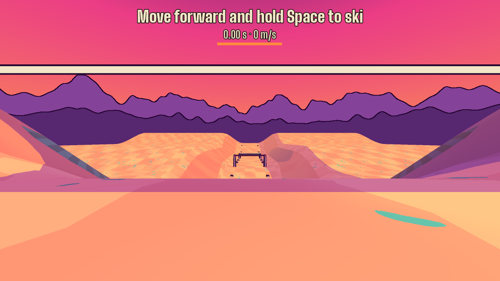
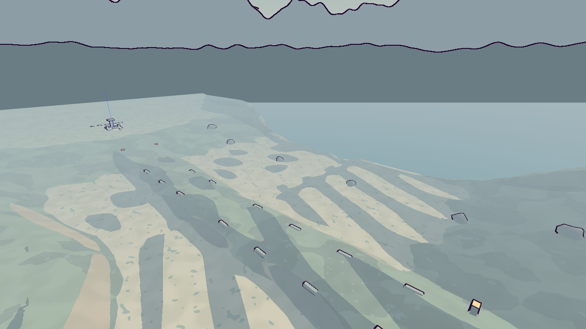
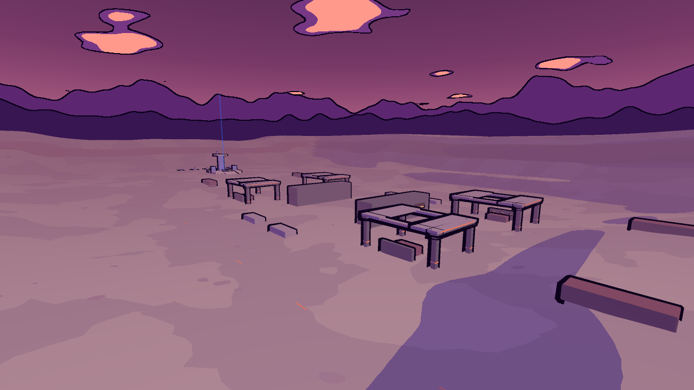
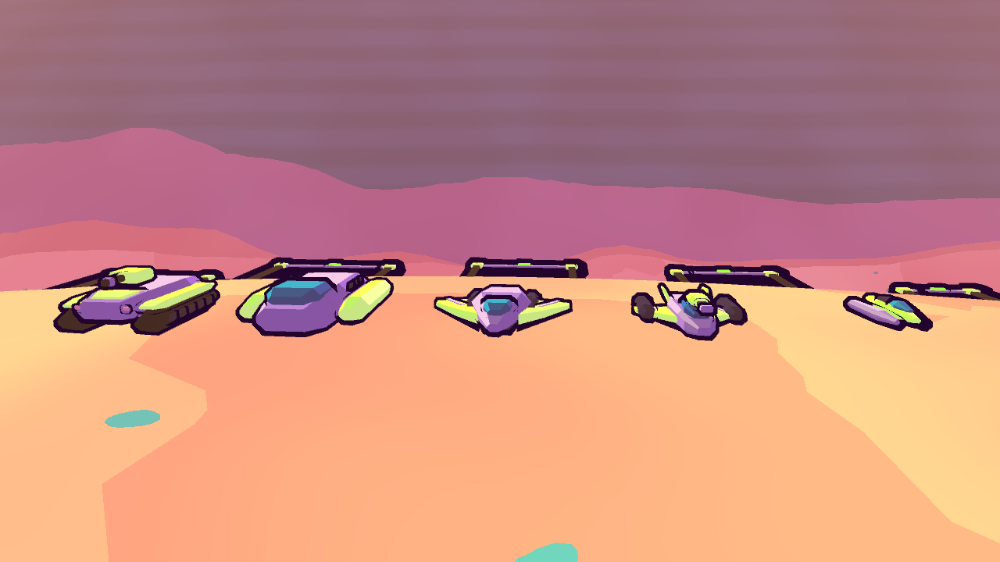
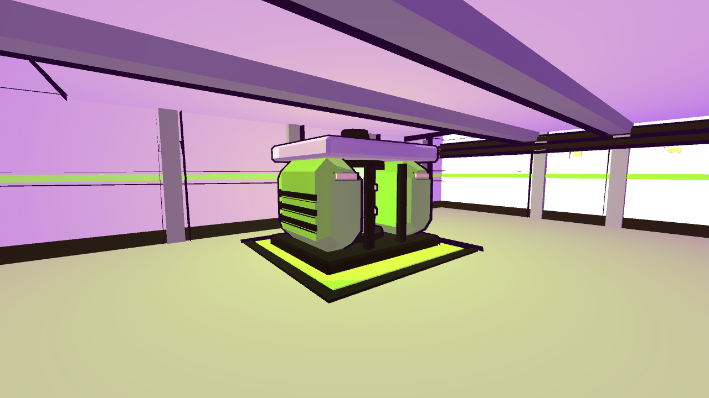

# Vectorfall

Vectorfall is a capture-the-flag shooter for Android and Linux. Ski down a hill, jet over the next ridge and bring the other team's flag home. Fly a gunship to cover your runner, or go in on foot and knock out the enemy generator.

It's in the spirit of Tribes, with the look of a science fiction paperback. Lime and Blue play on ten arenas with up to eight soldiers a side. Bots can fill both teams, drive and fly vehicles, repair the base and take orders from you. The game is offline in 0.12.0. Online play is planned.

New in 0.12.0

- Ferry pilots wait for passengers, pick landing sites and slow down to drop troops near the enemy base.
- Gunship crews cover friendly flag runners and intercept enemy carriers. Tank and bomber crews leave when their targets are gone.
- Footsteps are quieter, the jetpack holds a steady note and weapons, radio calls and flag cues have a lower pitch.

Added in 0.11.0

- Nine new arenas, a timed Ski Practice course and ten original music tracks.
- Distinct sounds for shield hits and airborne direct hits, plus a notice when an enemy flag carrier is stopped.

Let me know what works and what doesn't, or open an issue here.

Enjoy, 
Dan

---

## Screenshots

<table>
  <tr>
    <td align="center"> Main menu</td>
    <td align="center"> White Signal</td>
  </tr>
  <tr>
    <td align="center"> Ski Practice</td>
    <td align="center"> Flying a Needlewing</td>
  </tr>
  <tr>
    <td align="center"> Glass Ravine</td>
    <td align="center"> Gannet Reach</td>
  </tr>
  <tr>
    <td align="center"> Nightline Foundry</td>
    <td align="center"> The fleet</td>
  </tr>
  <tr>
    <td align="center"> Generator room</td>
  </tr>
</table>

---

## Install

Download the APK or Debian package from [the releases page](https://github.com/roge-rm/Vectorfall/releases).

- Android 7.0 and up, on 32-bit or 64-bit ARM. Open `vectorfall-0.12.0.apk` and follow the install prompt. If you installed a debug APK, remove it first. That clears the debug build's saved settings and loadouts.
- Debian 13 on 64-bit x86. Install `vectorfall_0.12.0_amd64.deb` with `sudo apt install ./vectorfall_0.12.0_amd64.deb` from the download folder, then open Vectorfall from the applications menu. The game needs OpenGL 3.3.

Android supports touch, gyro aim and gamepads. Linux supports a mouse and keyboard or a gamepad.

## Playing

Choose **How to Play → Ski Practice** for a timed run with a reset button and a saved best time. Hold jump as you go downhill to ski and pick up speed. Jet over the next rise, then let go of jet to refill your energy before the next climb.

Choose **Play** to pick an arena, team, bot count and skill for each side, time limit and capture limit. Touch the enemy flag to take it, then bring it to your stand while your own flag is home. Touch your dropped flag to return it, or wait 30 seconds for it to return on its own.

Use Orders to send bots after the flag, call for cover or get help with the base. Commander mode in Settings gives you more control of team assignments.

### Loadouts and base equipment

Light armour carries up to two weapons, medium carries three and heavy carries four. Armour determines which weapons you can take and how many grenades and mines you can carry. There are seven weapons, including the disc launcher, chaingun, sniper rifle and mortar. Save a loadout and change it while dead or at a friendly inventory station.

Take a repair pack to bring a generator back online. The generator powers the base turrets, sensors, inventory station and vehicle pads. A deployable pack lets you place a field turret, sensor or inventory station on clear ground. Field equipment has its own power.

### Vehicles

| Vehicle | What it does |
|---|---|
| Tern Sled | A fast grav bike for getting across the map. |
| Basalt Crawler | A tank with a cannon. Passengers can fire their own weapons. |
| Needlewing | A gunship with a second seat for the gunner. |
| Cinder Kite | A bomber that drops shells on targets below. |
| Morrow Ferry | A troop transport. Passengers can fire their own weapons. |

Walk up to a stopped or slow-moving friendly vehicle with an open seat and press Board. Look to steer and use the normal move controls to drive. When piloting an aircraft, jet climbs and jump descends. On touch those buttons read UP and DOWN. Keep your generator running so the pads can replace lost vehicles.

## Arenas

| Arena | Routes and landmarks |
|---|---|
| Ochre Fold | Long ski runs across sand ridges between hilltop bases. |
| Saltwake Flats | An open salt pan with a drainage cut and a wind berm on the sides. |
| Nightline Foundry | Casting bays give infantry cover, with service roads around the yard. |
| Copper Steps | Ramps climb the rock shelves to the flag decks, with ferry pads below. |
| Caldera Relay | Take the crater floor or stay high on either rim. |
| Gannet Reach | Cross by the cliff path, the raised causeway or the tidal flats. |
| White Signal | A tunnel through the snow, with open routes to either side. |
| Glass Ravine | A high bridge, broken crossings and routes along the canyon ledges. |
| Greenfall Terraces | Switchbacks through green terraces, with routes along both banks. |
| Beacon Wreck | Cargo bays through a wreck, with dune routes on either side. |

Match Setup also has a small Test map.

## Controls

| | Keyboard and mouse | Gamepad | Touch |
|---|---|---|---|
| Move and look | WASD and mouse | Left and right sticks | Left stick and drag on the right |
| Fire | Left click | Right trigger | FIRE, or drag from FIRE to aim while shooting |
| Jump and ski | Space, hold to ski | A, hold to ski | JUMP, hold to ski |
| Jet | Shift or right click | Left trigger or LB | JET |
| Change weapon | 1 to 4, Q or wheel | Y or RB | Tap the weapon name |
| Use pack or place equipment | E, or G to place | X | PACK or PLACE |
| Grenade and mine | F and C | D-pad left and right | GREN and MINE |
| Loadout | I or B | Back | LOADOUT |
| Board or exit | R | B | BOARD or EXIT |
| Orders and pause | V then a number, Esc to pause | D-pad up and Start | ORDERS and the pause button |

Settings has look speed for each input, touch button size, gyro aim, aim assist and auto ski. You can also change render scale, view distance and outlines, and set separate volumes for effects, voices and music.

## Building

Use the Godot 4.7.2 Linux editor at `tools/godot/Godot_v4.7.2-stable_linux.x86_64`. Put an empty `._sc_` file beside the editor to keep its settings local. Install the matching export templates to build packages. For Android, set the Android SDK and Java 21 paths in the editor settings. For Debian packaging, install `dpkg-deb` and ImageMagick.

- `tools/run.sh` runs the game from source. Add `-- --map test` to open the test map.
- `tools/build-linux.sh --release` exports a standalone 64-bit Linux executable.
- `tools/package-deb.sh` builds the Debian amd64 package.
- `tools/build-android.sh` builds a debug APK for ARM. Add `--emulator` for x86-64.
- `tools/run-tests.sh` runs the headless tests. Pass names such as `arena_map_test` or `ski_practice_test` to run selected tests.
- `tools/bot-match.sh --map nightline_foundry --bots 8 --seed 1 --minutes 5` runs a bot match and writes the report to `build/bot-reports/`.

## Licence

GPLv3 or later. See [LICENSE](LICENSE). Big Shoulders Display and IBM Plex Serif are under the SIL Open Font License 1.1. Their licence files are in [art/fonts](art/fonts).
