# Vectorfall

Vectorfall is a team shooter for Android, Linux and browsers. Ski down a hill, jet over the next ridge and bring the other team's flag home. Fly a gunship to cover your runner, or go in on foot and knock out the enemy generator.

Play Capture the Flag or Capture and Hold, with up to eight soldiers a side locally or sixteen a side on a dedicated server. Bots can fill both teams, drive and fly vehicles, repair the base and take orders from you.

Let me know what works and what doesn't in the #vectorfall channel [on my discord](https://discord.gg/9Wun47jGC6), or open an issue here.

Enjoy, 
Dan

---

## Gameplay

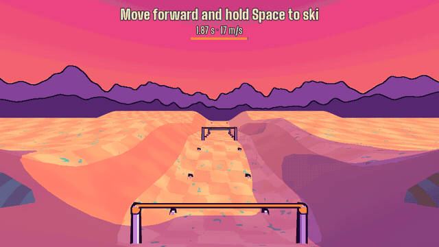

## Screenshots

<table>
  <tr>
    <td align="center">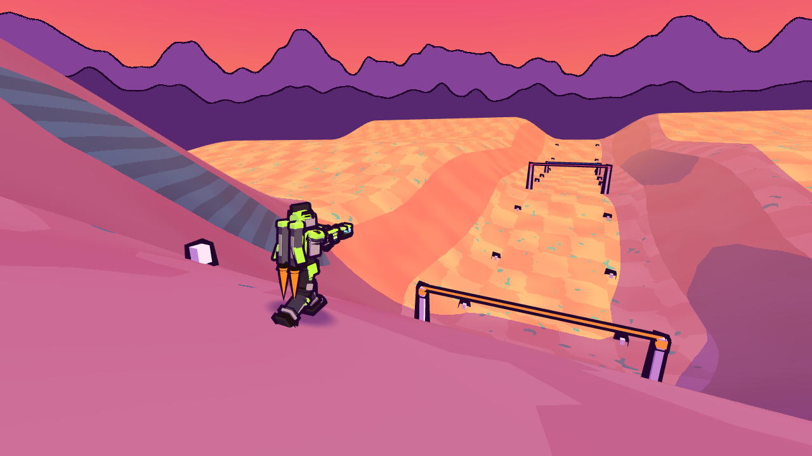 Ski Practice</td>
    <td align="center">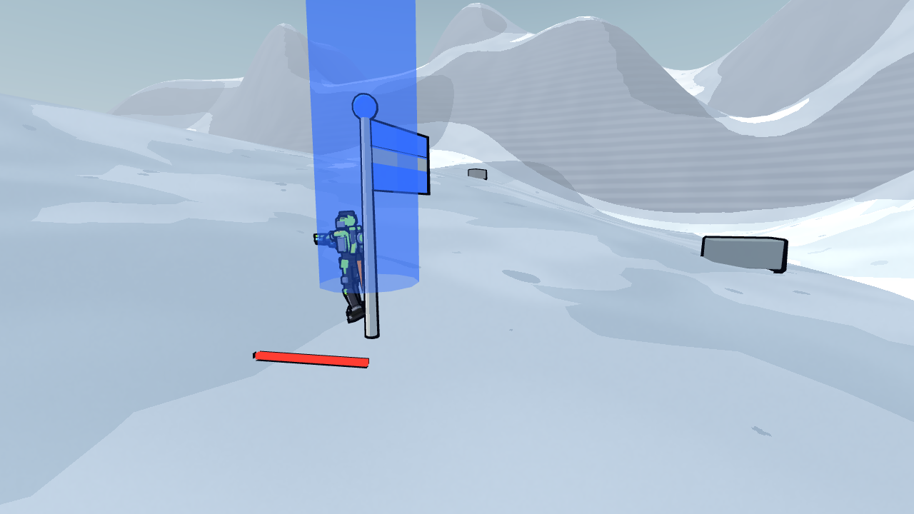 White Signal flag escape</td>
  </tr>
  <tr>
    <td align="center">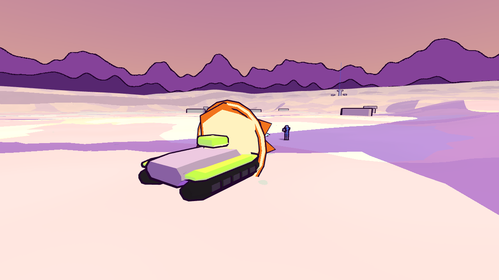 Tank ambush on Saltwake Flats</td>
    <td align="center">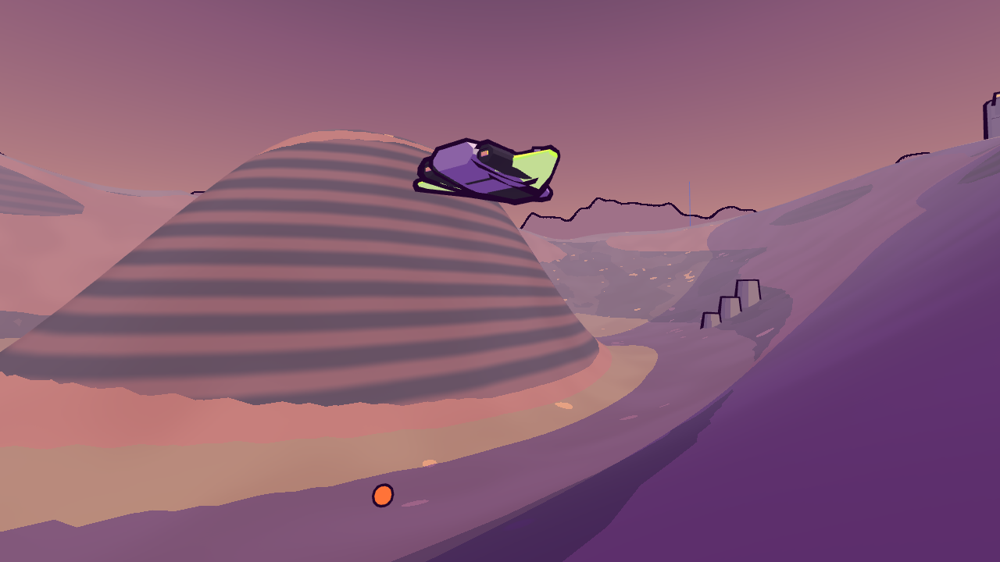 Bombing run on Caldera Relay</td>
  </tr>
  <tr>
    <td align="center">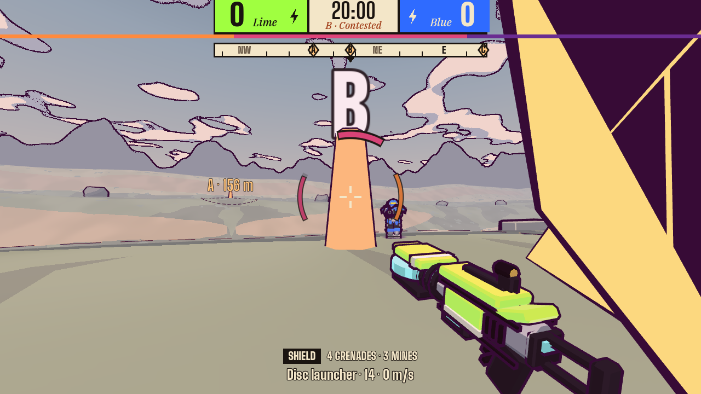 Contesting B on Gannet Reach</td>
    <td align="center">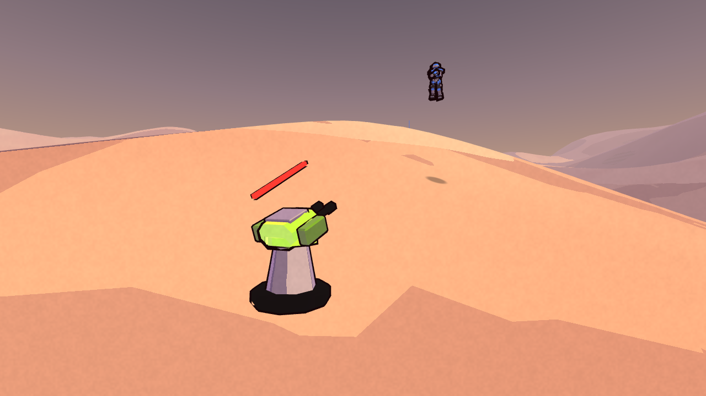 Turret defence on Beacon Wreck</td>
  </tr>
  <tr>
    <td align="center">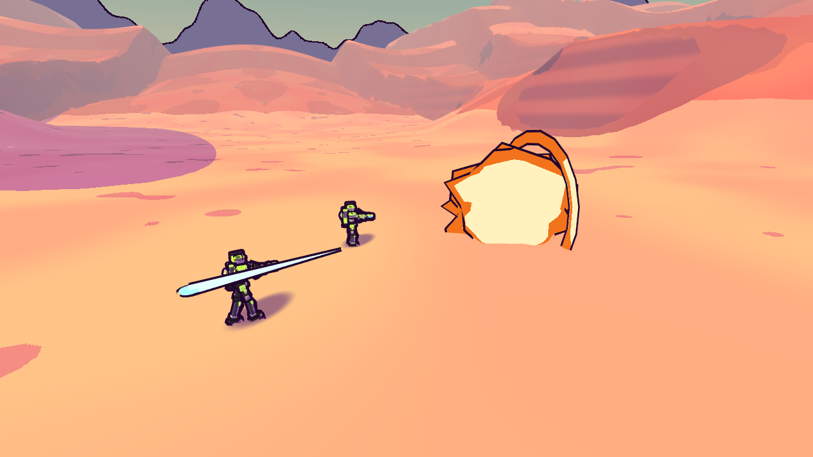 Disc crossfire on Copper Steps</td>
    <td align="center">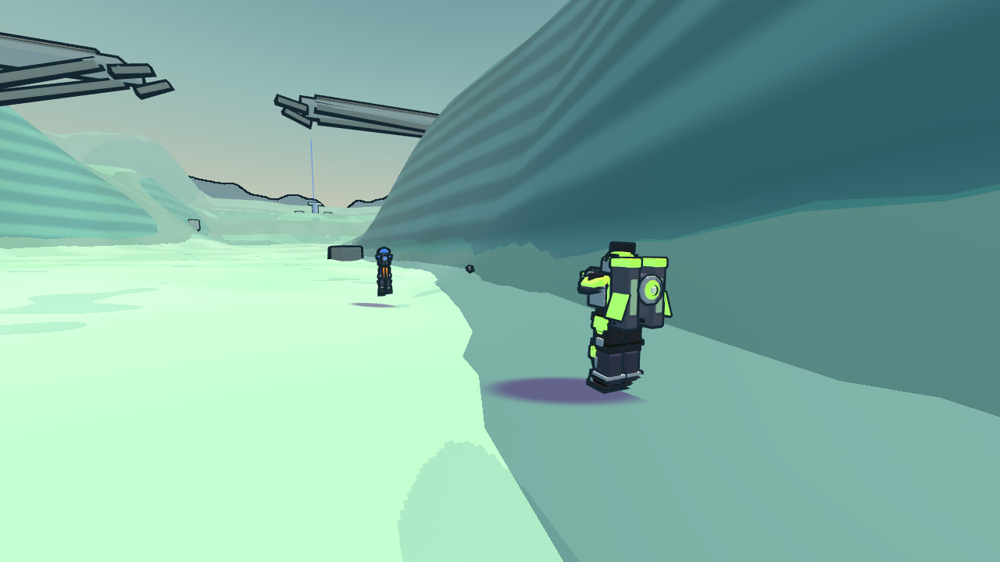 Grenade throw on Glass Ravine</td>
  </tr>
  <tr>
    <td align="center">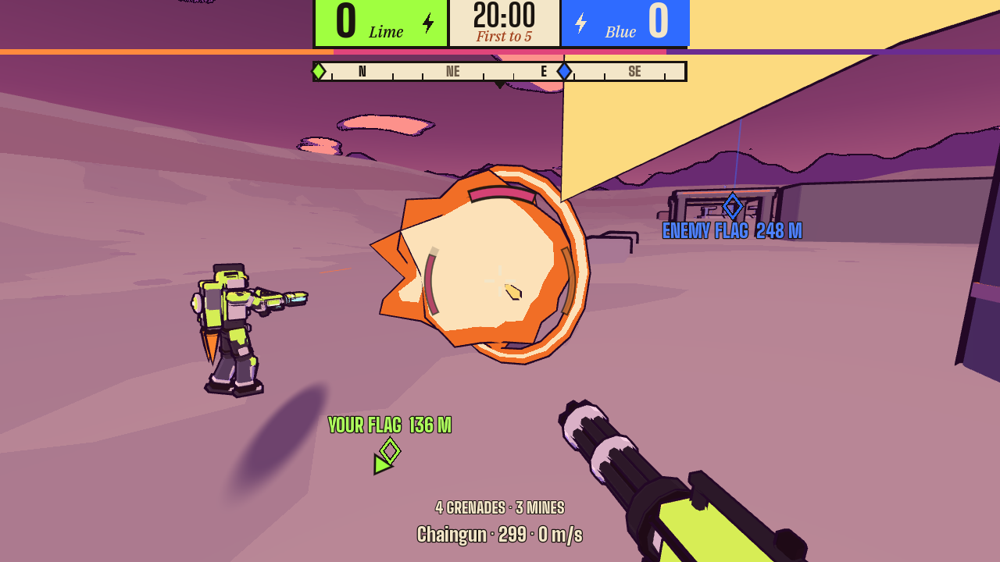 Chaingun assault on Nightline Foundry</td>
    <td align="center">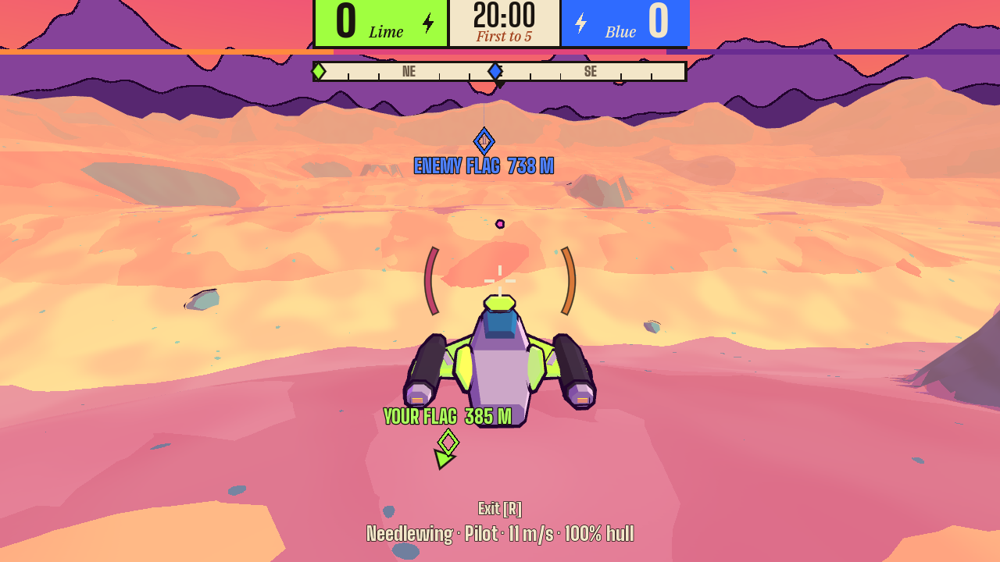 Needlewing attack on Ochre Fold</td>
  </tr>
</table>

---

## Install

Download the APK or Debian package from [Releases](https://github.com/roge-rm/Vectorfall/releases), or [play in your browser](https://hunke.ws/fdroid/play/vectorfall/).

- Android 7.0 and up, on 32-bit or 64-bit ARM. Add [my F-Droid repo](https://hunke.ws/fdroid/) or open `vectorfall-0.15.0.apk` and follow the install prompt. If you installed a debug APK, remove it first. That clears the debug build's saved settings and loadouts.
- Debian 13 on 64-bit x86. Add [my apt repo](https://hunke.ws/apt/) and run `sudo apt install vectorfall`, or run `sudo apt install ./vectorfall_0.15.0_amd64.deb` from the download folder. Open Vectorfall from the applications menu. The game needs OpenGL 3.3.
- Raspberry Pi OS Trixie on 64-bit ARM. Run `sudo apt install ./vectorfall_0.15.0_arm64.deb` from the download folder. The game uses OpenGL ES 3.0.
- Windows on 64-bit x86. Unzip the Windows download and open `Vectorfall.exe`.
- macOS on Intel or Apple Silicon. Unzip the macOS download and open `Vectorfall.app`. The app is ad-hoc signed and may need approval in Privacy & Security.

Android supports touch, gyro aim and gamepads. Linux supports a mouse and keyboard or a gamepad.

Choose Xbox or Nintendo under Gamepad layout in Settings. On the Retroid Pocket Duo, the bottom screen shows a different splash image on each launch, the live team map during a match and the results at the end of the round.

## Playing

Open `Online`. Pick a game on your LAN or enter a server address. Bots fill the empty slots. A dedicated server can run 16v16. See the [dedicated server guide](server/README.md) for Docker Compose, the dashboard and the browser build.

Open `How to play` and choose `Ski practice`. Hold jump on the way down a hill. Jet over the next rise. Let go of jet to refill your energy. You can reset the run. The game saves your best time.

Open `Play` to set up a local match. Pick one of ten arenas. Pick Lime or Blue. Set the number of bots and their skill for each side. Set the time and capture limits. Local matches go up to 8v8.

Touch the enemy flag to take it. Bring it back to your stand when your own flag is home. Touch your dropped flag to return it. It returns on its own after 30 seconds.

Give bots orders to go for the flag, cover you or help at the base. Turn on `Commander mode` in `Settings` to assign roles. Bots can drive and fly vehicles and repair the base.

### Capture and hold

Choose any map in `Match setup` and set `Mode` to `Capture and hold`.

Stay inside a control point for three seconds with no enemies inside to take it. Your team gets a point for every five seconds it holds. Enemies in the area stop the points. The team with the most points when time runs out wins.

On Nightline Foundry and Gannet Reach, turn on `Midfield ammo` to add a resupply pad. Both teams can use it. Wait 12 seconds after a refill. Step back onto the pad to use it again. Use a base station to change your loadout or replace grenades, mines and deployables.

### Team map and results

Open the team map with M, the right stick button or `Map` on touch. Pick a teammate and a spot on the map, then press `Send waypoint`.

Open `Match results` after the match. An assist counts if you hurt an enemy in the eight seconds before a teammate kills them. An escort counts if you're within 35 metres of a teammate when they capture the flag. A repair counts when you bring a destroyed piece of equipment back online.

### Loadouts and base equipment

Light armour carries up to two weapons, medium carries three and heavy carries four. Armour determines which weapons you can take and how many grenades and mines you can carry. There are seven weapons, including the disc launcher, chaingun, sniper rifle and mortar. Change your loadout while dead or at a friendly inventory station. You can save loadouts.

Knock out the enemy generator to cut power to their base. The generator powers the turrets, sensors, inventory station and vehicle pads. Use a repair pack to bring it back online. Use a deployable pack to put a field turret, sensor or inventory station on clear ground. Field equipment has its own power.

### Vehicles

| Vehicle | What it does |
|---|---|
| Tern Sled | A fast grav bike for getting across the map. |
| Basalt Crawler | A tank with a cannon. Passengers can fire their own weapons. |
| Needlewing | A gunship with a second seat for the gunner. |
| Cinder Kite | A bomber that drops shells on targets below. |
| Morrow Ferry | A troop transport. Passengers can fire their own weapons. |

Walk up to a stopped or slow-moving friendly vehicle with a free seat. Press `Board`. Use the move controls to drive. Look where you want to turn. In an aircraft, press jet to climb and jump to descend. On touch those buttons read UP and DOWN. Keep your generator running so the pads can replace lost vehicles.

## Arenas

| Arena | Routes and landmarks |
|---|---|
| Ochre Fold | Long ski runs across sand ridges between hilltop bases. |
| Saltwake Flats | An open salt pan with a drainage cut and a wind berm on the sides. |
| Nightline Foundry | Casting bays give infantry cover, with service roads around the yard. |
| Copper Steps | Ramps climb the rock shelves to the flag decks, with ferry pads below. |
| Caldera Relay | Take the crater floor or stay high on either rim. |
| Gannet Reach | Cross by the cliff path, the raised causeway or the tidal flats. |
| White Signal | A tunnel through the snow, with open routes to either side. |
| Glass Ravine | A high bridge, broken crossings and routes along the canyon ledges. |
| Greenfall Terraces | Switchbacks through green terraces, with routes along both banks. |
| Beacon Wreck | Cargo bays through a wreck, with dune routes on either side. |

Choose `Test map` in `Match setup` for a smaller arena.

## Controls

| | Keyboard and mouse | Gamepad | Touch |
|---|---|---|---|
| Move and look | WASD and mouse | Left and right sticks | Left stick and drag on the right |
| Fire | Left click | Right trigger | FIRE, or drag from FIRE to aim while shooting |
| Jump and ski | Space, hold to ski | A or LB, hold to ski | JUMP, hold to ski |
| Jet | Shift or right click | Left trigger | JET |
| Change weapon | 1 to 4, Q or wheel | Y or RB | Tap the weapon name |
| Use pack or place equipment | E, or G to place | X | PACK or PLACE |
| Grenade and mine | F and C | D-pad left and right | GREN and MINE |
| Loadout | I or B | Back | LOADOUT |
| Board or exit | R | B | BOARD or EXIT |
| Orders and pause | V then a number, Esc to pause | D-pad up and Start | ORDERS and the pause button |

Open `Settings` to change look speed for each input, touch button size, gyro aim, aim assist or auto ski. Set the view distance, render scale and outlines there too. There are separate volume controls for effects, voices and music.

## What's new

New in 0.15.0

- Play Capture and Hold on any map.
- Start with Ski Practice in the bot ladder, then unlock Capture the Flag and Capture and Hold.
- Bots have callsigns. Flag runners get escorts and wait for them before going in.
- Hold the left bumper to ski. Tap it to jump. Use the left trigger to jet.
- On the Retroid Pocket Duo, the lower screen shows the team map, results and a splash shot that changes each launch.

New in 0.14.0

- Open the team map to see teammates, objectives and orders. Pick a teammate and send them a waypoint.
- Open Match results to see what each player did during the round.
- Play Capture and Hold on Nightline Foundry and Gannet Reach.
- Turn on Midfield ammo to try a neutral resupply pad on those two arenas.

New in 0.13.0

- Join an online match by address or find servers on your LAN. Bots fill the rest of the team.
- Run up to 16v16 on a dedicated server with Docker Compose. Follow the match from the web dashboard or join from a browser.
- Both teams have wider bases with three ramps and covered inventory bays.

## Building

Use the Godot 4.7.2 Linux editor at `tools/godot/Godot_v4.7.2-stable_linux.x86_64`. Put an empty `._sc_` file beside the editor to keep its settings local. Install the matching export templates to build packages. For Android, set the Android SDK and Java 21 paths in the editor settings. For Debian packaging, install `dpkg-deb` and either `librsvg2-bin` or ImageMagick.

- `tools/run.sh` runs the game from source. Add `-- --map test` to open the test map.
- `tools/build-linux.sh --release` exports a standalone 64-bit Linux executable.
- `tools/package-deb.sh` builds the Debian amd64 package. Add `--arch arm64` for the Raspberry Pi package and install the matching Linux arm64 export template.
- The [Desktop builds workflow](.github/workflows/desktop-builds.yml) builds the Raspberry Pi, Windows and macOS packages from release tags and checks that each one starts. To build an existing release from the Actions tab, enter its tag in the manual run.
- `tools/build-android.sh` builds a debug APK for ARM. Add `--emulator` for x86-64.
- Run `tools/prepare-android.sh` before exporting a release with the Android preset. It installs the Gradle template and adds the native Duo panel.
- `tools/run-tests.sh` runs the headless tests. Pass names such as `arena_map_test` or `ski_practice_test` to run selected tests.
- `tools/bot-match.sh --map nightline_foundry --bots 8 --seed 1 --minutes 5` runs a bot match and writes the report to `build/bot-reports/`.

## Licence

GPLv3 or later. See [LICENSE](LICENSE). Big Shoulders Display and IBM Plex Serif are under the SIL Open Font License 1.1. Their licence files are in [art/fonts](art/fonts).
